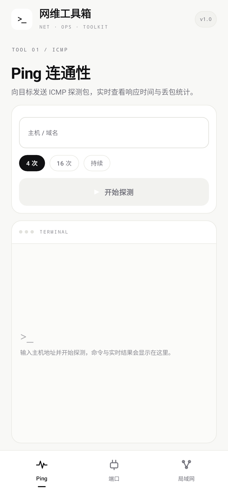
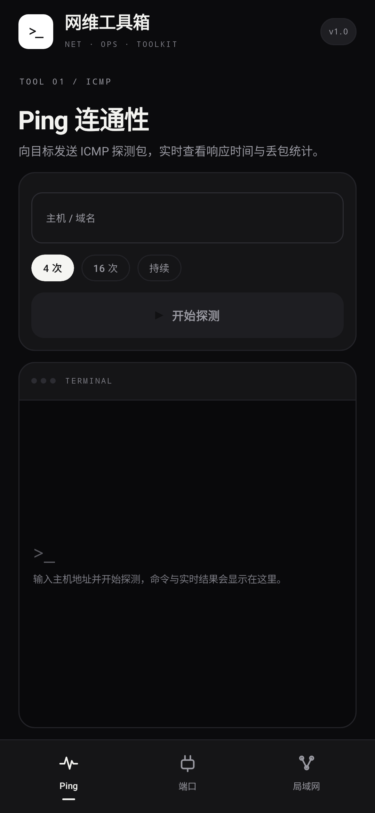
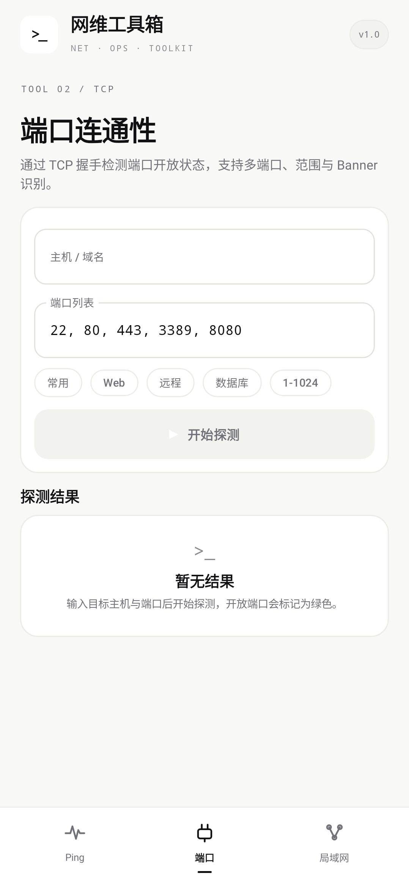
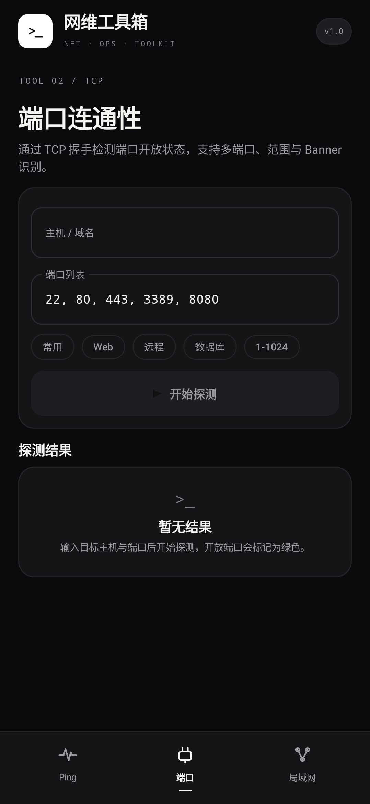
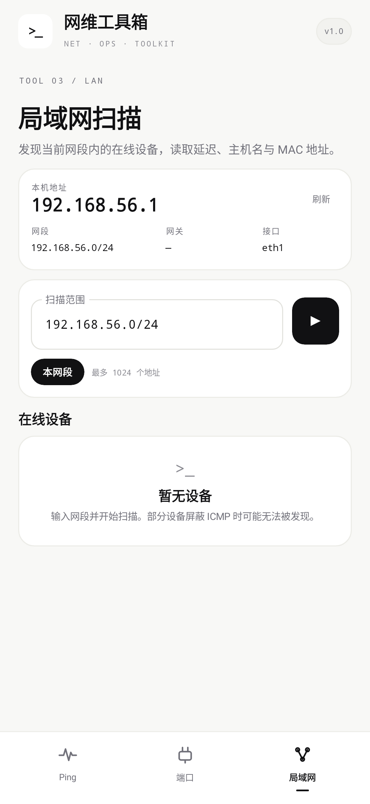
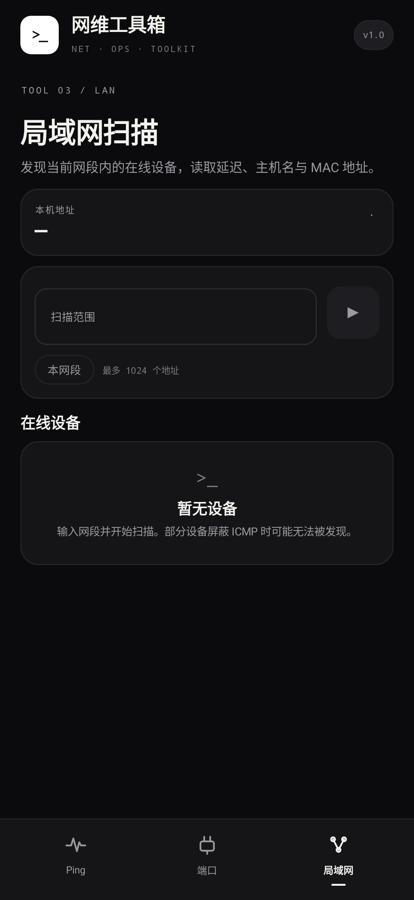

# 网维工具箱 · NetOps Toolbox

一个单机运行的 Android 网络运维工具箱：Ping 连通性、TCP 端口探测、局域网设备扫描。界面为黑白终端风格，默认白色主题，跟随系统自动切换深色模式；应用图标为白底黑色 `>_`。

- 包名：`com.qoder.netops`
- 版本：1.0.0（versionCode 1）
- 安装包：[GitHub Releases · v1.0.0](https://github.com/joah9806/netops-toolbox/releases/tag/v1.0.0)
- 最低系统：Android 8.0（API 26），targetSdk 35

## 功能

### Ping 连通性
- 通过系统 `ping` 命令发送真实 ICMP 探测包，支持 4 次、16 次和持续模式。
- 终端面板实时流式显示命令与输出，可复制全文、自动滚动。
- 结束后解析发送/接收数、丢包率、最小/平均/最大延迟。
- 随时停止探测。

### 端口连通性
- 通过 TCP `connect` 检测端口开放状态，单次最多 2048 个端口、并发 32。
- 支持逗号/空格分隔的端口列表，以及 `8000-8100` 范围写法。
- 内置常用、Web、远程、数据库、`1-1024` 预设。
- 对开放端口做 Banner 抓取并识别常见服务名。
- 结果按“开放优先”排序，标记开放、关闭、超时、错误。

### 局域网扫描
- 自动检测当前 Wi-Fi/有线网络的 IPv4 地址、掩码、CIDR、网关和接口。
- 支持 `192.168.1.0/24`、`192.168.1.1-254`、跨段范围和单个 IP，最多 1024 个地址。
- 并发 ICMP 探测，自动标注本机与网关；结合 ARP 表补全 MAC。
- 反向 DNS 解析主机名，内置常见厂商 OUI 表显示设备厂商。
- 实时显示扫描进度、在线设备数量和耗时，可中途停止。
- 支持“本网段”一键填入自动检测到的网段。

### 界面
- 白色/米白主界面，深色模式自动跟随系统。
- 自适应图标（含 Android 13 主题图标单色层）：白底、黑色 `>_`。
- 底部三栏切换；所有网络操作均由前台页面发起，无后台常驻服务。

## 截图

| | 浅色 | 深色 |
| --- | --- | --- |
| Ping |  |  |
| 端口 |  |  |
| 局域网 |  |  |

截图由 Robolectric 渲染测试生成，位于 `docs/screenshots/`。

## 安装

从 [Releases](https://github.com/joah9806/netops-toolbox/releases/latest) 下载 `NetOpsToolbox-1.0.0.apk`，或：

```bash
adb install -r NetOpsToolbox-1.0.0.apk
```

也可以把 APK 复制到手机，在文件管理器中打开并允许“安装未知应用”。

发布 APK 使用本地 release keystore 签名：

- 证书：`CN=NetOps Toolbox, OU=Personal, O=NetOps, L=Shanghai, ST=Shanghai, C=CN`
- 证书 SHA-256：`e1c1d2439bd6e465f5da85ceb72b74446b53cebdedd67651661b14c0a1388fe1`
- APK SHA-256：`23c7527b599e20f1e8865649c44c905cd7ba810163c8b0bbc5bc430dd1a488b0`

仓库不包含签名密钥和本地 SDK 配置。自行签名时，请生成 keystore 并配置 `keystore.properties`；正式分发前建议替换为你自己的签名。

## 使用提示

| 工具 | 输入示例 |
| --- | --- |
| Ping | `192.168.1.1`、`example.com` |
| 端口 | `22, 80, 443`、`8000-8100`、`22 80 443` |
| 局域网 | `192.168.1.0/24`、`192.168.1.1-254`、`192.168.1.1-192.168.1.99`、`192.168.1.10` |

- 端口范围越大耗时越长，`1-1024` 通常需要数十秒；可随时停止。
- 部分设备会屏蔽 ICMP，局域网扫描可能遗漏；ARP 表可帮助补全已通信设备。
- Android 10+ 对 `/proc/net/arp` 的访问受限，部分机型可能拿不到 MAC 地址。

## 构建

需要 JDK 17、Android SDK Platform 35 与 Build-Tools 35.0.0。

```bash
# 使用项目 wrapper（首次需要联网下载 Gradle 8.11.1）
./gradlew assembleRelease

# 或使用本机已安装的 Gradle
gradle assembleRelease
```

- 在项目根目录创建 `local.properties`，设置 `sdk.dir` 指向本机 Android SDK。
- release 签名配置从 `keystore.properties` 读取，keystore 路径相对项目根目录。
- 构建产物：`app/build/outputs/apk/release/app-release.apk`
- 发布包：`NetOpsToolbox-1.0.0.apk`（约 6.3 MB）

测试：

```bash
./gradlew testDebugUnitTest
```

- `NetParsersTest`：20 个单元测试，覆盖 CIDR/范围/端口解析、Ping 统计、网关、ARP/邻居表、服务名等。
- `AppRenderTest`：Robolectric + Compose 渲染冒烟测试，输出 6 张浅色/深色截图到 `app/build/ui-screenshots/`。

## 项目结构

```
app/src/main/java/com/qoder/netops/
├── MainActivity.kt
├── core/                 # 状态模型与 ViewModel
│   ├── Models.kt
│   ├── PingViewModel.kt
│   ├── PortViewModel.kt
│   └── LanViewModel.kt
├── net/                  # 网络探测与解析
│   ├── PingTool.kt
│   ├── PortScanner.kt
│   ├── LanScanner.kt
│   ├── LocalNetworkDetector.kt
│   ├── NetParsers.kt
│   └── OuiLookup.kt
└── ui/                   # Compose 界面
    ├── NetOpsApp.kt
    ├── PingScreen.kt
    ├── PortScreen.kt
    ├── LanScreen.kt
    ├── Components.kt
    └── theme/Theme.kt
```

技术栈：Kotlin 2.0.21、Jetpack Compose（BOM 2024.10.01 / Material3 1.3.1）、AGP 8.7.3、Gradle 8.11.1、Coroutines 1.9.0。

## 权限与隐私

- `INTERNET`：Ping、TCP 探测、反向 DNS。
- `ACCESS_NETWORK_STATE`、`ACCESS_WIFI_STATE`：识别当前网络状态与本机地址。
- 所有探测都在本机直接发起，不上传任何数据，无账号、无统计 SDK。

## 已知限制

- 尚未在真机上做完整回归；当前验证为编译、单元测试、签名校验和 Robolectric 渲染测试。
- 局域网发现基于 ICMP + ARP，屏蔽 ICMP 且未与手机通信的设备可能不出现。
- OUI 厂商表为精选内置表，未知前缀会显示为空。
- 部分定制系统限制读取 ARP 表，MAC 地址可能缺失。
- 未包含 traceroute、DNS 查询、Wake-on-LAN 等扩展功能。